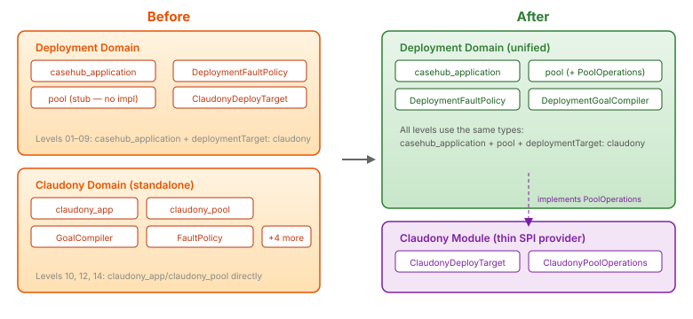
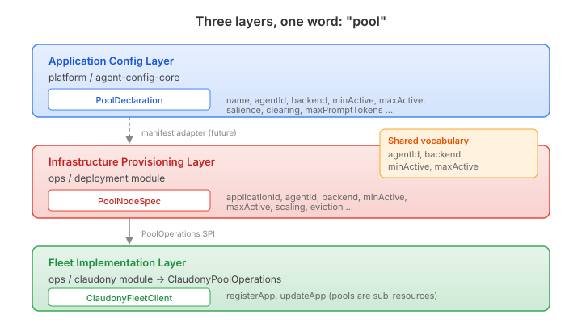
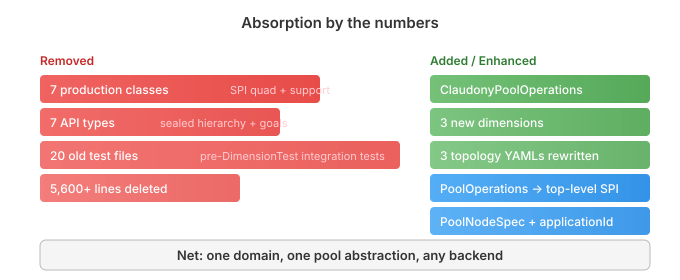

# When the Domain Boundary Is Wrong

I went into this session planning to rewrite three topology tests. Levels
10, 12, and 14 — the claudony-domain topologies — needed updating to use the
universal runtime image, the same pattern we'd applied to Levels 01 through 09
over the last few weeks. Should have been mechanical. Update the images, switch
to the DimensionTest pattern, move on.

It wasn't mechanical. The first question — "how does the universal runtime
image integrate with the claudony fleet API?" — exposed something I'd been
avoiding: the claudony module shouldn't be a standalone domain at all.

## The dual-path problem

The claudony module had grown into two distinct roles. Role one:
`ClaudonyDeploymentTarget`, an implementation of `ApplicationDeploymentTarget`
that the deployment domain uses to deploy apps via the fleet API. This is how
Levels 01–09 work — `casehub_application` nodes with `deploymentTarget: claudony`.
Clean, generic, target-agnostic.

Role two: a full standalone domain with its own SPI quad — goal compiler, actual
state adapter, node provisioner, fault policy — managing `claudony_app` and
`claudony_pool` node types. This is what Levels 10, 12, and 14 used. Same fleet
API underneath. Different domain boundary on top.

The question from first principles: are pool management, fault recovery, and
adaptation rules claudony-specific? If I added a Kubernetes deployment target
tomorrow, would I want pools? Fault recovery? Adaptation? Obviously yes. These
are deployment-domain capabilities that happen to have been implemented first
against claudony. Keeping them locked in the claudony domain means rebuilding
them for every new target.

## The infrastructure that was already there

Here's the part that stung. I started designing a new `casehub_pool` node type
with a `PoolManagementTarget` interface for the deployment domain. Clean SPI,
interface segregation, the whole thing.

Then Claude searched for existing pool infrastructure and found it: `PoolNodeSpec`,
`PoolProvisionHandler`, `PoolDriftChecker`, and `PoolOperations` — all designed,
tested with stubs, sitting in the deployment module with no production
implementation. The same codebase. I'd either built this and forgotten, or
approved the design and never circled back.

The prepared infrastructure had richer semantics than what I was proposing. Scaling
policies, eviction strategies, working directory management. The `PoolOperations`
SPI already defined `getPool`, `createPool`, `updatePool`, `destroyPool`. The
right move was obvious: don't invent; complete.

## Four pools walk into a codebase

I raised a sharper point during design: "we have pool concepts in platform too —
we need coherent language across repos."

So we searched. Four distinct "pool" concepts across the casehub family:

The platform's `PoolDeclaration` declares what the app wants: "give me a pool of
warm sessions backed by Claude, minimum two, maximum five." The ops deployment
module's `PoolNodeSpec` provisions it: "deploy and maintain two to five agent
instances on the claudony fleet." The claudony module's `ClaudonyPoolNodeSpec`
is the mechanism: read-modify-write on the parent app's pool list via the fleet
API.

Three layers, same word, genuinely different concerns. The naming turned out to be
coherent already — `agentId`, `backend`, `minActive`, `maxActive` appear in all
three. What was missing was the explicit pipeline connecting them, and the
production implementation that closes the loop between declaration and provisioning.

## What the review caught

We captured eight design decisions and ran a light adversarial review. Two
findings changed the design materially.

First: the fault policy decision was entirely redundant. I'd proposed generalising
`ClaudonyFaultPolicy` into a configurable `DeploymentFaultPolicy` with a new
generic `human_review` node type. The reviewer found that `DeploymentFaultPolicy`
already exists, uses the same `ThresholdFaultPolicy` builder pattern, and has
domain-specific review nodes (`deployment-review`, `iot-review`, etc.). The "design
decision" reduced to adding `NodeType.of("pool")` to an existing `nodeTypes` set.
One line.

Second: the `PoolOperations` interface I'd described as "a prepared SPI in the
deployment module" was actually a nested inner interface inside `PoolProvisionHandler`.
Not a first-class SPI at all — an implementation detail that happened to have the
right shape. It needed promotion to a top-level type in the API module, contract
changes to scope pools by parent application, and a `backendId()` method for
multi-backend dispatch. The review caught the gap between what I claimed existed
and what actually existed.

Both findings made the design simpler. The fault policy went from a new class with
YAML configuration to a one-line change. The pool SPI went from "just use the
existing interface" to "promote, enhance, then use" — more honest about the work
required, but building on real infrastructure instead of inventing from scratch.

## What the implementation revealed

The plan had nine tasks across five batches. The first three — pool infrastructure
foundation — went cleanly. Promote `PoolOperations` to a top-level SPI, add
`applicationId` to `PoolNodeSpec`, wire multi-backend dispatch through both handler
and drift checker. Each change rippled through test stubs across the deployment
module, but the ripple was mechanical: update constructor signatures, add
`backendId()` implementations, thread `applicationId` through calls.

`ClaudonyPoolOperations` was the first production implementation of the
`PoolOperations` SPI. The interesting part wasn't the implementation — it was
the concurrency model. The claudony fleet API models pools as sub-resources of
apps: provisioning a pool means reading the parent app, modifying its pool list,
and writing the entire app back. Concurrent pool operations on the same parent
race. The implementation uses per-application `ReentrantLock` — simple, correct
for a single-process fleet client.

The topology YAML rewrites collapsed fictional per-service images (manifest,
eidos, engine) into the universal runtime pattern. Level 10's five `claudony_app`
nodes became three: `platform`, `support-app`, and a `pool` node. Level 12 went
from four nodes to two. The topologies got simpler because the deployment domain's
`casehub_application` type with `deploymentTarget: claudony` is more expressive
than raw `claudony_app` nodes — it carries deployment metadata the claudony
domain couldn't represent.

The cleanup was where scope surprised me. Deleting seven production classes and
seven API types was expected. What wasn't expected: twenty old integration tests
across Levels 02–14 still imported the deleted `ClaudonyNodeProvisioner` test
double. These were the pre-DimensionTest integration tests — superseded by the
`@DimensionTest` pattern we'd built over the preceding weeks but never
explicitly removed. The domain absorption forced the cleanup that should have
happened incrementally.

## The SPI quad as a domain design tool

The broader point is about how the desiredstate SPI quad — goal compiler, actual
state adapter, node provisioner, fault policy — acts as a forcing function for
domain design.

When I built the claudony domain, the quad made it easy to give claudony its own
compilation, its own state checking, its own provisioning, its own fault handling.
Each SPI has a clear responsibility. Fill in the four slots and you have a
working domain. The quad is a good servant.

But it's also a mirror. When the answers to "who compiles, who checks, who
provisions, who handles faults?" are "the same logic with a different REST client
underneath" — the quad is telling you this isn't a domain. It's a backend.

The claudony module's SPI quad was doing deployment-domain work through a
claudony-shaped hole. Pool compilation was deployment goal compilation with
claudony field names. Actual state checking was deployment drift checking with
claudony API calls. Fault handling was deployment fault policy with a
claudony-branded review node. The only genuinely claudony-specific part was the
provisioner's read-modify-write on the fleet API — and that's exactly what
`ClaudonyPoolOperations` encapsulates now.

## Where this goes

The topology ladder is coherent now. Levels 01 through 14 all use the same types:
`casehub_application` for apps, `pool` for managed instance fleets,
`deploymentTarget: claudony` for the backend. No domain switch mid-climb.

The prepared infrastructure — `PoolNodeSpec`, `PoolProvisionHandler`,
`PoolDriftChecker` — is live. A `KubernetesPoolOperations` implementing
`PoolOperations` would give Kubernetes the same pool management without
touching the deployment domain. That was the promise of the boundary redesign.
Whether the promise holds depends on whether the `PoolOperations` contract is
genuinely backend-agnostic or whether claudony's sub-resource model leaked into
the interface. The `applicationId` scoping and CRUD shape suggest it's clean,
but a second backend is the real test.

The platform-to-ops pool pipeline — connecting `PoolDeclaration` to
`PoolNodeSpec` via a manifest adapter — is future work. The field vocabulary
is aligned. The compilation path exists. The bridge is an integration concern,
not an architectural one.
